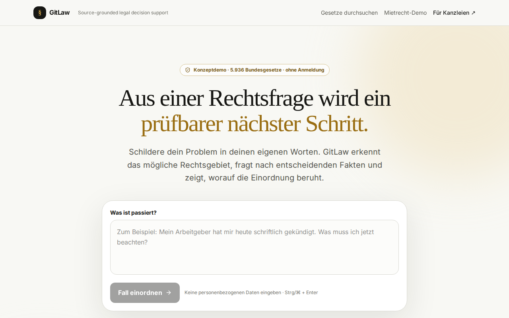

# GitLaw — Source-grounded German legal research

*Real saved application screenshot; the live interface may have changed.*

**[Open the public GitLaw prototype](https://mikelninh.github.io/gitlaw/)**

Independent developer prototype, not legal advice and not a substitute for verification of authoritative, up-to-date primary legal sources.

> We measure our success not by what we create, but by what changes because we created it.

## Impact card · 2026-11-19

| Project | Now → Desired change | Next action and measurable success |
| --- | --- | --- |
| GitLaw | Searchable statutory source retrieval exists; end-to-end legal conclusion quality is not independently established → People retrieve and verify applicable source provisions faster | Ask a qualified reviewer to score 30 new research questions. Measure exact citation correctness, missing or outdated sources, appropriate abstention and time to verified answer. |

**Evidence rule:** document counts, citation retrieval tests and semantic similarity are not legal correctness or proven professional time savings. Every generated claim must link to a retrievable primary source and be reviewable by a human.

**Guiding line:** Love is our intention. Action is our expression. Impact is our evidence.
