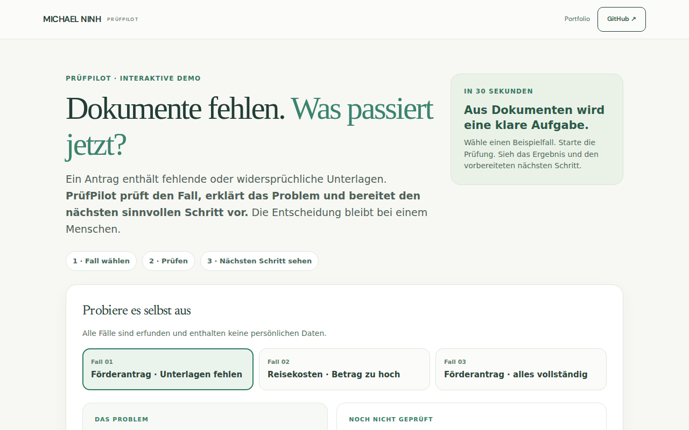

# PrüfPilot — missing-document workflow

**[Try the public prototype](https://mikelninh.github.io/pruefpilot/)**

*Actual browser screenshot, captured on 19 November 2026. This is a developer prototype, not an independently evaluated administrative service.*

> We measure our success not by what we create, but by what changes because we created it.

## Impact card

| Project | Now → Desired change | Next action and measurable success |
| --- | --- | --- |
| PrüfPilot | Missing-document assistance exists as a prototype; no real service-benefit baseline established → People get reliable next steps with fewer mistakes and delays | Have a domain reviewer judge 20 unseen cases. Track correct next steps, critical errors, unclear source claims and minutes per case versus manual handling. |

**Safeguard:** All real eligibility, administrative decisions and customer communications require authorised human review. Do not interpret screenshots or synthetic tests as verified time savings.

**Guiding line:** Love is our intention. Action is our expression. Impact is our evidence.
